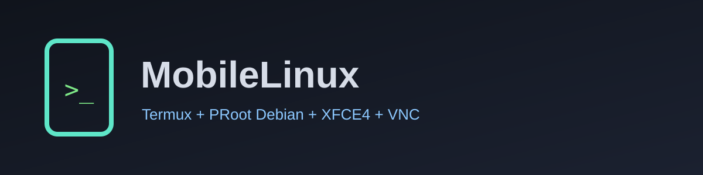

<div align="center">



# MobileLinux

**A lightweight Linux desktop + web-dev toolkit that runs inside Termux on Android.**
Termux · PRoot Debian · XFCE4 · TigerVNC · VS Code (code-server) · optional AI helper

[](https://github.com/rakib2313/MobileLinux/actions/workflows/shellcheck.yml)
[](LICENSE)


</div>

```text
 __  __       _     _ _
|  \/  | ___ | |__ (_) | ___
| |\/| |/ _ \| '_ \| | |/ _ \
| |  | | (_) | |_) | | |  __/
|_|  |_|\___/|_.__/|_|_|\___|
 _     _
| |   (_)_ __  _   ___  __
| |   | | '_ \| | | \ \/ /
| |___| | | | | |_| |>  <
|_____|_|_| |_|\__,_/_/\_\
```

> **What this is not:** MobileLinux is not an operating system, an Android replacement, a custom ROM
> or a strong security sandbox. It runs a Debian userland through PRoot inside the Termux app.
> It is unofficial and not affiliated with Linux, Debian, Termux or Android.

> **Test status:** the scripts are syntax-checked automatically. They have **not** been verified
> on a real device by the generator. Please report what works or fails on your phone (see
> *Reporting an issue*).

## What you get

A one-command installer that sets up a Linux desktop (viewed through a VNC app) with Chromium,
Firefox ESR, Node.js, Python 3, PHP CLI, Git and VS Code (code-server). It picks a `low`, `mid` or
`high` profile from your RAM. Primary target: **ARM64 (aarch64)** phones.

## Requirements

| Item | Requirement |
|------|-------------|
| Android | 8.0+ (Android 12+: see the *phantom process* note under Troubleshooting) |
| Termux | Latest from **F-Droid** or **GitHub** (the Play Store build is outdated) |
| Storage | 5 GB free recommended (3 GB minimum) |
| RAM | 3 GB+ (4 GB comfortable) |
| VNC app | RealVNC Viewer, bVNC or similar |

## Install (review first)

Run these **in Termux**:

```bash
pkg install -y git
git clone https://github.com/rakib2313/MobileLinux.git
cd MobileLinux
less scripts/install.sh          # read it first (press q to quit)
bash scripts/install.sh
```

A one-line `curl | bash` bootstrap also exists inside `install.sh`, but reading the code before
running it is safer. Installation takes roughly 10-30 minutes.

## The installer interface

The installer shows a text logo, a short welcome, and **8 numbered phases**:

| # | Phase | Runs in |
|---|-------|---------|
| 1 | Welcome and device checks (Termux, CPU, commands, storage, RAM, network) | Termux |
| 2 | Termux dependencies (`pkg update`, `proot-distro`, ...) | Termux |
| 3 | Debian PRoot setup (reuses an existing Debian; never deletes it) | Termux + Debian |
| 4 | Desktop and VNC (XFCE4, TigerVNC, browsers, VNC password) | Debian |
| 5 | Development tools (Node.js, Python, PHP, Git, code-server) | Debian |
| 6 | Optional AI helper (asks first) | Debian |
| 7 | Optional Termux theme (asks first) | Termux |
| 8 | Final verification and next-step commands | Termux + Debian |

Long steps show a spinner with elapsed time and the last log line. A failed step is never reported
as success: the last log lines are printed, and the installer stops with an **error screen** that
names the phase, whether the failure was in **Termux** or **Debian**, the step, the exit code, the
log location and a next step. Optional components (code-server, browsers, extensions, AI helper,
theme) are reported separately from required ones; the core install stays usable if they fail.

### Display options (animation and colour)

| Option | Effect |
|--------|--------|
| `--no-animation` (or `MLD_NO_ANIM=1`) | No logo reveal or spinner; plain progress lines |
| `--no-color` (or `NO_COLOR=1`, `MLD_NO_COLOR=1`) | No colours |
| `--ascii` (or `MLD_ASCII=1`) | Plain ASCII symbols instead of Unicode |
| `-v`, `--verbose` | Stream live command output instead of a spinner |

Animation and colour are used only on an interactive terminal; when output is piped or
`TERM=dumb`, the installer prints plain text. On very narrow terminals (under ~34 columns) the logo
becomes a one-line title. Actual appearance varies by terminal, font, screen width and Termux version.

### Other installer options

`--profile low|mid|high|auto`, `--yes`, `--no-code-server`, `--ai` / `--no-ai`, `--theme` /
`--no-theme`, `--allow-no-sandbox`, `--refresh`, `--help`. `--yes` never grants consent for the
theme or the browser-sandbox change.

## Daily use

| Command (in Termux) | What it does |
|---------|--------------|
| `mld start` | Start the desktop |
| `mld stop` / `mld restart` | Stop / restart it |
| `mld status` | Show whether it is running |
| `mld passwd` | Change the VNC password |
| `mld resolution 1280x720` | Change screen size (then `mld restart`) |
| `mld shell` / `mld root` | Terminal inside Linux (user / root) |
| `mld ai ...` | Optional AI helper |
| `mld code-password` | Show the VS Code login password |
| `mld browser-sandbox on\|off\|status` | Browser sandbox choice (see Security) |
| `mld theme apply\|restore\|status\|backups` | Optional Termux theme |
| `mld diagnose [--log] [--save] [--no-guest]` | Local diagnostics |
| `mld log [N]` | Show the last N log lines |
| `mld autostart on\|off` | Start at boot (needs the Termux:Boot app) |
| `mld update` | Pull the latest version and re-apply configs |
| `mld uninstall` | Remove what was installed |

**Connect:** after `mld start`, open your VNC viewer app and connect to **`localhost:5901`** with
your VNC password. Stop with `mld stop`. VNC listens on this phone only; VNC password login does
**not** encrypt traffic.

## Optional Termux theme

The theme changes **only the colours of the Termux terminal** (`~/.termux/colors.properties`). It
does **not** change the Android system theme, the XFCE desktop, or your VNC viewer app. No font is
downloaded or changed.

```bash
mld theme apply       # asks for consent, backs up your file, installs the theme
mld theme restore     # puts your previous file back
mld theme status      # exit code 0 = MobileLinux theme active
mld theme backups     # list backups
```

* Backups live in `~/.termux/mobilelinux-backups/` as `colors.properties.<YYYYMMDD-HHMMSS>`.
  An existing backup is never overwritten, and this project never deletes backups.
* If you edit `colors.properties` after applying the theme, `restore` first saves your edited file
  as `colors.properties.before-restore-<timestamp>` and asks before replacing it.
* The record of what was backed up is `~/.termux/mobilelinux-backups/state`.
* The installer applies the theme only if you say yes (or pass `--theme`). Skipping or a failure
  does not affect the Linux installation.
* If Termux does not reload automatically, run `termux-reload-settings` or fully close and reopen
  Termux.

## Diagnostics, logs and reporting an issue

* **Log file:** `~/.cache/mld/mld.log` (mode `600`; override with `MLD_LOG_FILE`). If it cannot be
  written, the installer warns and falls back to `$TMPDIR`, then to live output only.
  View it with `mld log` or `tail -n 100 ~/.cache/mld/mld.log`.
* **Diagnostics:** `mld diagnose` (or `bash scripts/diagnose.sh`) prints Termux detection, CPU
  architecture, RAM and storage (with their limits), commands, PRoot-Distro/Debian status,
  VNC status and the component checks inside Debian. Add `--log` to include the last 40 log lines,
  `--save` to also write `~/mld-diagnostics-<time>.txt` (mode `600`). **Nothing is uploaded.**
* **Before sharing:** open the output or log yourself, and delete anything private (passwords,
  tokens, e-mail addresses, personal paths or device identifiers). A masking filter hides common
  secret patterns, but it is not a guarantee.
* **Reporting:** open an issue at https://github.com/rakib2313/MobileLinux/issues with your
  Android version, device model, Termux version/source, the phase and step that failed, and the
  smallest relevant part of the (redacted) log. Never post passwords, API keys or tokens.

## Troubleshooting

| Problem | Fix |
|---------|-----|
| Installer stopped | Read the error screen (phase, Termux vs Debian, step, exit code). Re-run `bash scripts/install.sh`: finished steps and an existing Debian are reused; nothing is deleted. |
| Partial installation | Re-run the installer. Run `mld diagnose` to see which components are missing. Required components must pass phase 8 before the installer says "complete". |
| Network check failed | Switch to Wi-Fi, check `curl -I https://deb.debian.org`, re-run. |
| `The Debian container was not created` | Run `proot-distro install debian` to see the real error, then re-run the installer. |
| Installer looks stuck | Use `--verbose`, or in a second Termux session: `tail -f ~/.cache/mld/mld.log`. Desktop and development package steps have no hard deadline by default; `MLD_DESKTOP_TIMEOUT` and `MLD_DEVTOOLS_TIMEOUT` set seconds, and `MLD_APT_TIMEOUT` sets a guest apt deadline (0 disables). Other steps can still have time limits. A quiet log does not prove a hang. |
| Spinner/colours look wrong | Use `--no-animation --no-color --ascii`. |
| VNC viewer cannot connect | `mld status`; connect to `localhost:5901`; check `~/.mld/run/desktop.log`. |
| Grey screen / no panel | `mld restart`. Still broken: `mld shell`, then `rm -rf ~/.config/xfce4`, and restart. |
| Browser will not start | PRoot cannot run browser sandboxes. Read the security notes, then decide: `mld browser-sandbox on`. |
| Desktop dies in the background (Android 12+) | Run `termux-wake-lock`; enable *Developer options -> Disable child process restrictions*, or via ADB: `adb shell device_config put activity_manager max_phantom_processes 2147483647`. |
| code-server missing | It is optional (needs github.com and an ARM64/x86_64 CPU). Re-run the installer later. |
| `apt` errors inside Linux | Close other package managers first. Enter Debian with `proot-distro login debian`, run `dpkg --configure -a` and `apt-get -f install`, then exit and retry. Never remove dpkg lock files while a package manager may be running. |
| VNC password tool missing | In Debian as root run `apt-get update && apt-get install tigervnc-tools`, then retry. The installer checks `tigervncpasswd` and `vncpasswd`. |

Performance is limited: PRoot adds overhead, there is no GPU acceleration, and phones throttle when
hot or on low battery.

## Security notice

* VNC and code-server listen on **localhost only**.
* Browser sandboxes are **on by default**; disabling them is opt-in and risky (see `SECURITY.md`).
* No secrets live in this repo. Passwords and API keys are prompted at runtime and stored with `600`.
* The optional AI helper sends your prompts to an external provider; that leaves your phone and may
  cost money.
* Direct downloads (code-server) are fetched over HTTPS; the installer prints the SHA-256 but cannot
  verify it against a publisher checksum.

## Project structure

```text
MobileLinux/
├── .github/workflows/      shellcheck.yml, release.yml
├── assets/                 banners/ and logos/
├── configs/
│   ├── chromium/flags.conf
│   ├── profiles/           low.conf, mid.conf, high.conf
│   ├── termux/colors.properties
│   ├── vnc/xstartup
│   └── vscode/             settings.json, extensions.txt
├── scripts/
│   ├── install.sh          master installer (Termux)
│   ├── mld.sh              the `mld` command
│   ├── setup-vnc.sh        VNC + desktop setup/runtime (Debian)
│   ├── setup-theme.sh      optional Termux theme (apply/restore)
│   ├── diagnose.sh         local diagnostics
│   ├── ai-assistant.sh     optional AI helper
│   ├── uninstall.sh
│   ├── lib/                common.sh (logging, redaction), ui.sh (logo, spinner, screens)
│   └── guest/              provision.sh, install-apps.sh, verify.sh, browser-sandbox.sh,
│                           mld-code.sh, sync-in.sh
├── .env.example  .gitignore  .gitattributes
└── LICENSE  README.md  SECURITY.md
```

## Uninstall

```bash
mld uninstall
```

Removes the launcher and project state and, only if you type `DELETE`, the Debian environment
(including everything in it). It offers to restore your Termux colours. The log and theme backups
are kept.

## Contributing

1. Fork and create a feature branch.
2. Run `shellcheck -x -S warning scripts/*.sh scripts/*/*.sh`.
3. Open a pull request describing the change and the device you tested on.

## License

Released under the [MIT License](LICENSE).
